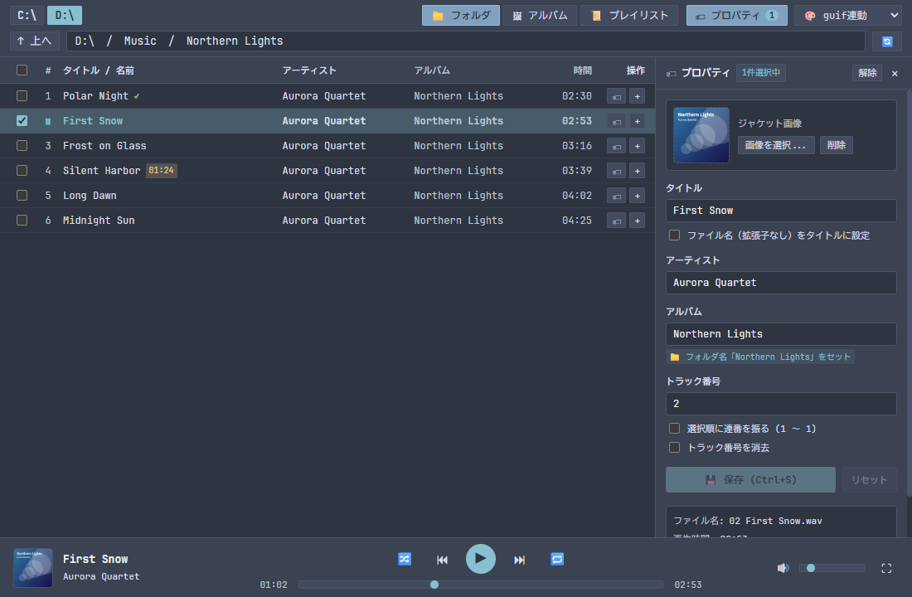
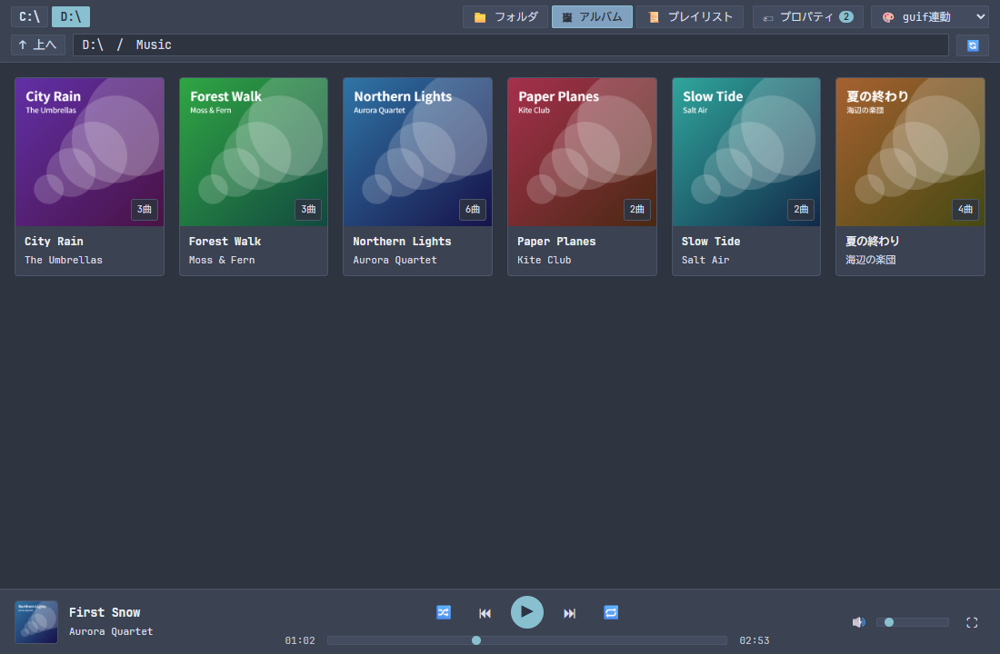
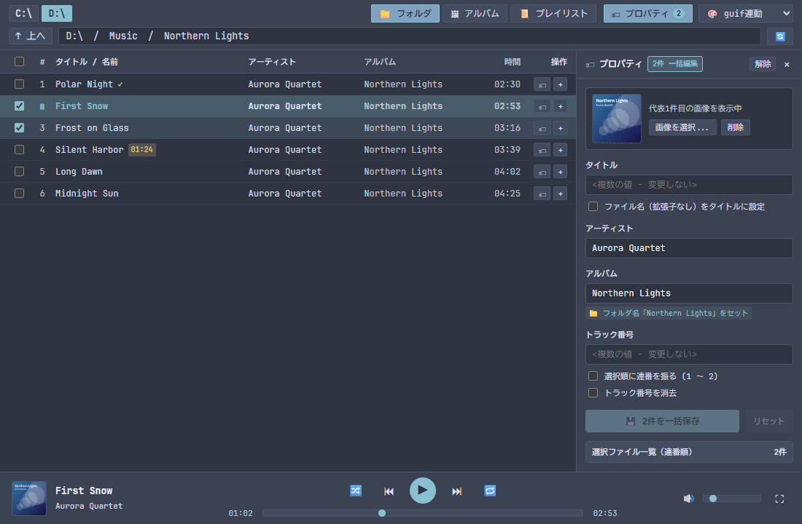

# guif-player-win

[](https://github.com/Az-kijitra/guif-player-win/actions/workflows/ci.yml)
[](LICENSE)

`guif-player` は、フォルダー階層のまま音楽を聴く Windows 10 / 11 向けの音楽プレーヤーです(**Tauri 2 + Rust + Svelte 5** 製)。キーボードだけでも、マウスだけでも操作できます。

ファイラー [guif](https://github.com/Az-kijitra/guif) と共通の配色と設計を使っています。



---

## 主な機能

- **フォルダーのまま聴く**: ライブラリーの登録は不要です。フォルダーを開いて再生します。
- **続きから聴く**: 曲ごとに再生位置を記憶し、次の起動では前回のフォルダーを開きます。
- **タグの編集**: タイトル、アーティスト、アルバム、トラック番号、ジャケットを、複数の曲にまとめて書き込めます。
- **安全な保存**: 一時コピーへ書き込んで音声とタグを確認してから、元のファイルと置き換えます。失敗しても元のファイルは変わりません。
- **アルバムビュー**: フォルダーごとのジャケットを一覧で表示します。
- **プレイリスト**: 作成、追加、削除ができます。
- **シャッフルとリピート**: 全曲を重複なく流すシャッフル、1 曲リピート、全曲リピートがあります。
- **キーボード操作**: 一覧の移動、範囲選択、再生の操作、ビューの切り替えをキーボードだけで行えます。
- **テーマ**: Nord、Default、Monokai、Catppuccin、Solarized、Light から選べます。guif の設定に合わせることもできます。

<table>
  <tr>
    <td></td>
    <td></td>
  </tr>
</table>

### 対応形式

MP3 (`.mp3`)、FLAC (`.flac`)、AAC / ALAC (`.m4a`、`.aac`)、Ogg Vorbis (`.ogg`)、WAV (`.wav`)、AIFF (`.aif`、`.aiff`)

Opus (`.opus`) には今後対応する予定です。WMA (`.wma`) と、DRM で保護された曲(iTunes Store の古い購入曲や Apple Music の曲など)は再生できません。

---

## インストール

インストーラーは最初のリリースで配布する予定です。それまではソースからビルドしてください。

```powershell
git clone https://github.com/Az-kijitra/guif-player-win.git
cd guif-player-win/app
npm install
npm run tauri build
```

必要なものは Rust 1.90 以上、Node.js 22.12 以上、Microsoft Edge WebView2 ランタイムです。

---

## 主なキー

| キー | 動作 |
|---|---|
| `Space` | 再生 / 一時停止 |
| `↑` `↓` `Enter` | 一覧の移動、再生、フォルダーを開く |
| `Backspace` | 親フォルダーへ |
| `Ctrl+→` / `Ctrl+←` | 次の曲 / 前の曲 |
| `Alt+→` / `Alt+←` | 5 秒進む / 5 秒戻る |
| `Ctrl+1` / `Ctrl+2` / `Ctrl+3` | フォルダー / アルバム / プレイリストのビュー |
| `Shift` + 移動キー | 範囲選択 |
| `Ctrl+S` | タグの保存 |

全一覧は[ユーザーマニュアル](docs/user_manual.md#5-キー操作)にあります。

---

## データの保存先

再生位置、プレイリスト、設定は `%LOCALAPPDATA%\dev.guif.player\guif_player.db` に保存します。0.1.1 以前のデータは、起動したときに自動で新しい場所へ移動します。

ネットワークへの送信はしません。

---

## ドキュメント

- [ユーザーマニュアル](docs/user_manual.md): 操作、タグの編集、トラブルシューティング
- [変更履歴](CHANGELOG.md)
- [開発への参加](CONTRIBUTING.md): 開発環境とテスト
- [アーキテクチャ](docs/architecture.md): 内部構造と設計の理由
- [仕様](specs/README.md): 受入基準とテストの対応
- [セキュリティ](SECURITY.md): 脆弱性の報告

---

## ライセンス

[MIT License](LICENSE)

同梱する第三者のソフトウェアは [THIRD_PARTY_NOTICES.md](THIRD_PARTY_NOTICES.md) にあります。
