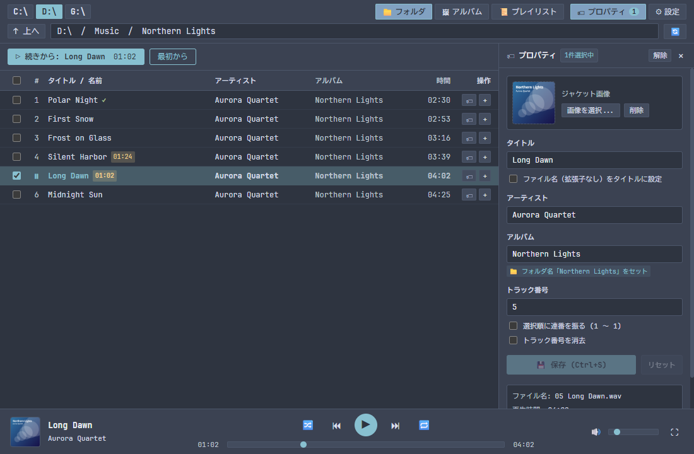
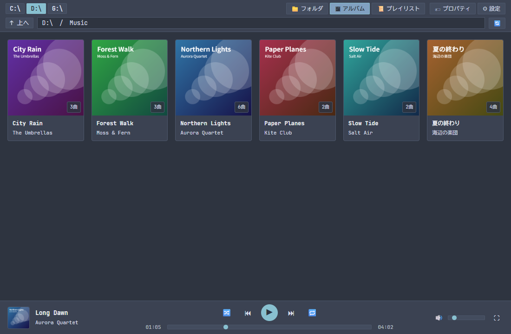
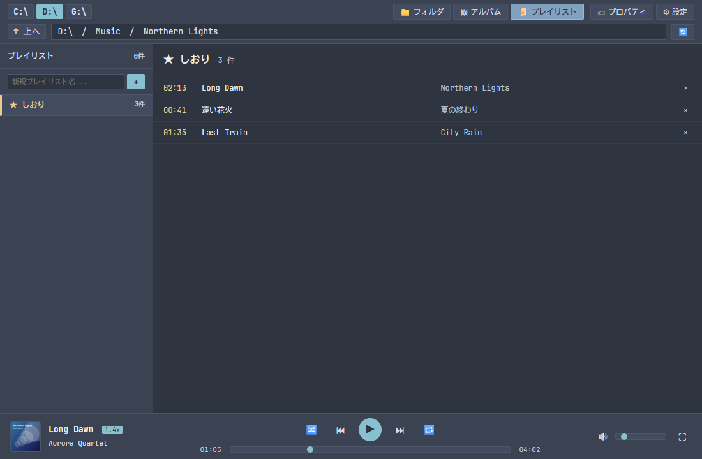
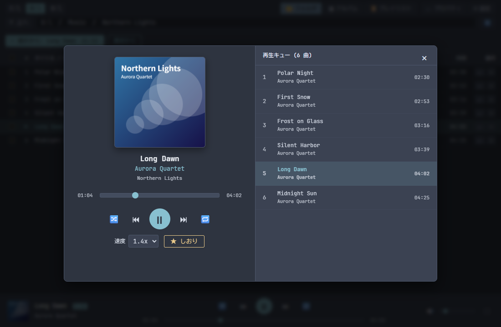
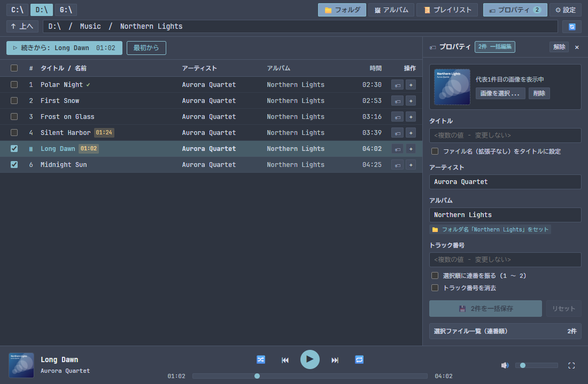

# guif-player ユーザーマニュアル

guif-player は、フォルダー階層のまま音楽を聴く Windows 用の音楽プレーヤーです。キーボードだけでも、マウスだけでも操作できます。

対象環境は Windows 10 または Windows 11(64 ビット版)です。

## 1. インストールとアンインストール

### 1.1 インストール

1. インストーラー `guif-player_<版>_x64-setup.exe` を実行します。
2. 画面の案内に従って進めます。インストールは現在のユーザーだけで、管理者権限は不要です。インストール先は `%LOCALAPPDATA%\guif-player` です。
3. スタートメニューの「guif-player」から起動します。

Microsoft Edge WebView2 ランタイムがない PC では、インストーラーがインターネットから取得して導入します。

### 1.2 SmartScreen の警告

インストーラーにはコード署名がありません。「Windows によって PC が保護されました」と表示されたときは、「詳細情報」を選び、表示される「実行」を押します。入手元が [Releases](https://github.com/Az-kijitra/guif-player-win/releases) であることを確かめてから実行してください。

### 1.3 更新

新しいインストーラーをそのまま実行します。再生位置、プレイリスト、設定は引き継がれます。

### 1.4 アンインストール

Windows の「設定」の「アプリ」から「guif-player」をアンインストールします。

- 「アプリケーションデータを削除する」のチェックを外したまま(既定)なら、再生位置、プレイリスト、設定は残り、再インストールで引き継がれます。
- チェックを入れると、これらも削除します。

音楽ファイルはどちらの場合も削除しません。

## 2. 画面

画面は次の 4 つに分かれています。

| 場所 | 内容 |
|---|---|
| 上部 | ドライブの切り替え、ビューの切り替え、現在の場所、テーマ |
| 中央 | 曲とフォルダーの一覧(フォルダー / アルバム / プレイリストの 3 つのビュー) |
| 右 | プロパティパネル(タグの編集)。`Ctrl+I` で開閉します |
| 下部 | 再生バー(再生操作、シーク、音量) |

再生バーの曲名の部分か、右端のボタンを押すと、大きなジャケットと再生キューを表示する詳細プレーヤーが開きます。`Esc` で閉じます。

## 3. 音楽を聴く

### 3.1 フォルダービュー

フォルダーを開くと、中のフォルダーと曲を一覧で表示します。フォルダーが先に並び、曲はトラック番号の順に並びます。

- 曲をクリックするか `Enter` を押すと、その曲から再生します。同じフォルダーの曲が再生キューになります。
- フォルダーをクリックするか `Enter` を押すと、中へ移動します。
- `Backspace` または `Alt+↑`、「↑ 上へ」で親フォルダーへ戻ります。

曲のあるフォルダーでは、一覧の上に再生のボタンを表示します。

| ボタン | 動作 |
|---|---|
| ▷ 続きから: 曲名 | 最後に聴いていた曲の続きから再生します。その曲を聴き終えていれば次の曲から、最後の曲まで聴き終えていれば 1 曲目から再生します |
| 最初から | 1 曲目の最初から再生します |
| ▷ 最初から再生: 曲名 | まだ聴いていないフォルダーで、1 曲目から再生します |

一覧の印の意味は次のとおりです。

| 印 | 意味 |
|---|---|
| `✓` | 最後まで聴いた曲 |
| 時間(例: `01:24`) | 途中まで聴いた曲。その位置から再開します |
| `前回再生` | 前回最後に再生していた曲 |

### 3.2 アルバムビュー

今のフォルダーの下にあるアルバムを、ジャケットの一覧で表示します。カードを開くと、そのアルバムのフォルダーへ移動します。

- 曲が入っているフォルダーを 1 つのアルバムとして扱います。
- 今のフォルダーから 3 階層下までを探します。それより深いフォルダーは表示しません。
- ジャケットは、先頭の曲に埋め込まれた画像を使います。なければ、同じフォルダーの画像を使います(`cover`、`folder`、`front`、`artwork` という名前の `.jpg`、`.jpeg`、`.png`)。

### 3.3 プレイリスト

プレイリストビューの左の欄に名前を入れて作ります。同じ名前のプレイリストは作れません。曲は、一覧の「+」ボタンか `P` キーで追加します。

- 同じ曲を何度でも追加できます。曲を外すと、そのプレイリストにある同じ曲がすべて外れます。
- プレイリストの削除には確認が出ます。音楽ファイルは削除されません。
- 「▶ 全曲再生」は先頭の曲から順に再生します。「🔀 シャッフル再生」はシャッフルをオンにして、無作為に選んだ曲から再生します。
- プレイリストは曲の場所を記録しています。音楽ファイルを移動すると再生できなくなります。

見つからない曲は取り消し線で表示し、プレイリストを開いたときにその数を知らせます。

### 3.4 しおり

曲の好きな位置にしおりを挟み、あとでその位置から再生できます。

- 再生中に、詳細プレーヤーの「☆ しおり」を押すか `B` キーを押すと、今の位置に挟みます。
- しおりは 1 曲に 1 つです。同じ曲で挟み直すと、新しい位置に移ります。
- プレイリストビューの左の欄の「★ しおり」に、新しく挟んだ順に並びます。選ぶとその位置から再生し、同じフォルダーの残りの曲に続けます。
- `×` か `Delete` キーで削除します。音楽ファイルは削除されません。
- 曲を移動したり削除したりすると、再生できないことを知らせます。しおりは残ります。

### 3.5 再生速度

詳細プレーヤーの「速度」で、0.8 倍から 2.0 倍まで 0.2 刻みで選びます。`[` で遅く、`]` で速くなります。音の高さは変わりません。

速度はアプリ全体で 1 つで、曲を替えても、次に起動しても保ちます。1.0 倍以外のときは、再生バーの曲名の横に速度を表示します。

### 3.6 Windows のメディア操作

再生中の曲名、アーティスト、ジャケットを、Windows の音量の表示とロック画面に出します。そこから再生、一時停止、前後の曲を操作できます。キーボードのメディアキーと、ヘッドセットのボタンも使えます。

ヘッドホンを抜き差しするなどして Windows の既定の出力先が変わると、新しい出力先で同じ位置から再生を続けます。

### 3.7 再生の操作

| 操作 | 動作 |
|---|---|
| シャッフル | 全曲を重複なく一度ずつ、ばらばらの順に再生します |
| リピート | 押すたびに、オフ → 全曲 → 1 曲 と切り替わります |
| 前の曲 | 再生位置が 3 秒を過ぎていれば、その曲の先頭へ戻ります |

シャッフル中の「前の曲」は、実際に再生した順に戻ります。

キューの最後の曲が終わると再生は止まります。そのあと再生ボタンを押すと、最後の曲をもう一度再生します。

### 3.8 続きから聴く

再生位置は自動で記録します。

- 途中まで聴いた曲をもう一度再生すると、その位置から再開します。最後まで聴いた曲は先頭から再生します。
- 次に起動すると、前回聴いていたフォルダーを開きます。
- 一時停止したときと、別の曲に切り替えたときにも、その時点の位置を記録します。

再生位置の記録は 3 秒ごとです。アプリが異常終了すると、最後の数秒は失われることがあります。

## 4. 対応している形式

| 形式 | 拡張子 |
|---|---|
| MP3 | `.mp3` |
| FLAC | `.flac` |
| AAC / ALAC | `.m4a`、`.aac` |
| Ogg Vorbis | `.ogg` |
| Opus | `.opus` |
| WAV | `.wav` |
| AIFF | `.aif`、`.aiff` |

次のものは再生できません。

- WMA(`.wma`)
- DRM で保護された曲(iTunes Store の古い購入曲や Apple Music の曲など)。再生しようとすると、画面にその旨を表示します。

## 5. タグを編集する

曲を選ぶと、右のプロパティパネルでタイトル、アーティスト、アルバム、トラック番号、ジャケット画像を編集できます。`Ctrl+S` か保存ボタンで音楽ファイルに書き込みます。

### 5.1 複数の曲をまとめて編集する

チェックボックス、`Ctrl+クリック`、`Shift+クリック`、`Ctrl+A`、`Shift` + 矢印キーで複数の曲を選びます。

- 値が曲ごとに違う欄には「複数の値 - 変更しない」と表示します。入力しなければ、その項目は変更しません。
- 入力した項目だけを、選んだすべての曲に書き込みます。

### 5.2 便利な機能

| 機能 | 動作 |
|---|---|
| ファイル名をタイトルに設定 | 拡張子を除いたファイル名をタイトルにします |
| フォルダ名をセット | フォルダーの名前をアルバム名に入れます |
| 選択順に連番を振る | 選んだ順に 1 から番号を付けます。順番は「選択ファイル一覧」で変えられます |
| トラック番号を消去 | トラック番号を消します |

### 5.3 ジャケット画像

「画像を選択」を押すか、画像をジャケットの場所へドロップします。使える形式は JPEG、PNG、GIF です。WebP は使えません。

### 5.4 保存のしくみと注意

保存では、次の手順で音楽ファイルを保護します。

1. 同じフォルダーに一時的なコピーを作り、そこへ書き込みます。
2. 再生時間、先頭 5 秒の音声、書き込んだタグを確認します。
3. 問題がなければ、元のファイルと置き換えます。

途中で失敗しても元のファイルは変わりません。

複数の曲を保存していて一部が失敗したときは、残りの曲の保存を続け、どの曲が保存できなかったかを画面に表示します。すべて失敗したときは入力内容が残るので、原因を取り除いてやり直せます。

次の点に注意してください。

- 読み取り専用のファイルは保存できません。
- ほかのアプリが開いているファイルは保存できないことがあります。再生中の曲は保存できます。再生はそのまま続きます。
- MP3 の ID3v1 タグと APE タグは更新しません。ID3v2 タグを読まない古い機器では、古いタイトルが表示されることがあります。
- 大切なライブラリーを一括編集する前には、バックアップをお勧めします。

## 6. キー操作

### 6.1 どこでも使えるキー

| キー | 動作 |
|---|---|
| `Space` | 再生 / 一時停止 |
| `Ctrl+→` / `Ctrl+←` | 次の曲 / 前の曲 |
| `Alt+→` / `Alt+←` | 5 秒進む / 5 秒戻る |
| `Ctrl+1` / `Ctrl+2` / `Ctrl+3` | フォルダー / アルバム / プレイリストのビューへ切り替え |
| `Backspace` / `Alt+↑` | 親フォルダーへ(フォルダービュー) |
| `Ctrl+A` | すべての曲を選択 |
| `Ctrl+I` | プロパティパネルの開閉 |
| `Ctrl+S` | プロパティの保存 |
| `B` | 再生中の曲の今の位置にしおりを挟む |
| `[` / `]` | 再生速度を遅く / 速く |
| `Ctrl+=` / `Ctrl+-` / `Ctrl+0` | 文字を大きく / 小さく / 標準に戻す |
| `Esc` | ダイアログや通知を閉じる / 一覧へ戻る |

文字の入力中は、`Space` や矢印キーは文字の入力に使われます。

### 6.2 一覧のキー

| キー | 動作 |
|---|---|
| `↑` / `↓` | 上下へ移動(アルバムビューでは `←` / `→` も使えます) |
| `PageUp` / `PageDown` | 1 画面分移動 |
| `Home` / `End` | 先頭 / 末尾へ移動 |
| `Enter` | 曲を再生 / フォルダーやアルバムを開く |
| `Shift` + 移動キー | 選択範囲を広げる |
| `Ctrl+Space` | 選択の切り替え |
| `I` | プロパティを編集 |
| `P` | プレイリストに追加 |

`Tab` を押すと、一覧からプロパティパネルなどの次の場所へ移ります。

### 6.3 プレイリストビューのキー

| キー | 動作 |
|---|---|
| `Enter`(左の欄) | プレイリストを開いて曲の一覧へ移動 |
| `→` / `←` | 左の欄と曲の一覧の間を移動 |
| `Delete` | プレイリストを削除(確認あり) / 曲をプレイリストから外す |

## 7. テーマと文字の大きさ

画面右上の「⚙ 設定」で、配色と文字の大きさを選びます。選ぶとすぐに画面に反映し、次の起動でも保ちます。

### 7.1 テーマ

Nord(既定)、Default、Monokai、Catppuccin、Solarized、Light があります。

「guif連動」を選ぶと、ファイラー [guif](https://github.com/Az-kijitra/guif) の設定ファイル(`%APPDATA%\dev.guif.app\config.toml` の `[theme]`)と同じ配色を使います。guif が入っていなければ Nord になります。

### 7.2 文字の大きさ

小(85%)、標準、大(115%)、特大(130%)から選びます。ブラウザーの拡大と同じく、画面全体を拡大します。`Ctrl + =` で大きく、`Ctrl + -` で小さく、`Ctrl + 0` で標準に戻します。

## 8. データの保存先

| データ | 場所 |
|---|---|
| 再生位置、プレイリスト、テーマ | `%LOCALAPPDATA%\dev.guif.player\guif_player.db` |

0.1.1 以前のデータ(`%LOCALAPPDATA%\guif-player\guif_player.db`)は、起動したときに自動で新しい場所へ移動します。

guif-player は、このほかにはタグを編集したときの音楽ファイルにだけ書き込みます。ネットワークへの送信はしません。

## 9. 困ったとき

| 症状 | 原因と対処 |
|---|---|
| 「DRM で保護された曲は再生できません」 | 保護された曲です。再生できません |
| 「対応していない形式か、ファイルが壊れています」 | 対応形式を確かめてください。ほかのプレーヤーでも再生できないなら、ファイルが壊れています |
| 「音声の出力先が見つかりません」 | スピーカーやヘッドホンを接続してください。接続すると、起動し直さなくても再生できます |
| タグを保存できない | 通知に理由を表示します。読み取り専用の解除や、ファイルを開いているアプリの終了を試してください |
| アルバムビューに表示されない | 今のフォルダーから 3 階層より深いフォルダーは表示しません。もっと近いフォルダーへ移動してください |
| 一覧に古いタグが表示される | 上部の更新ボタンを押してください |
| 「より新しい版の guif-player で作られたデータです」 | 新しい版のデータを古い版で開こうとしました。新しい版を使ってください |
